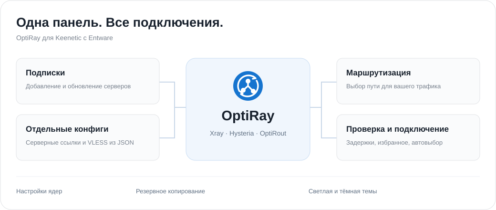

# OptiRay

**Веб-интерфейс для Xray, Hysteria и маршрутизации на Keenetic с Entware.**

[Канал Telegram](https://t.me/optiray_project) — релизы и новости · [Обсуждение и отзывы](https://t.me/optiray_project_chat)

OptiRay работает на Go, управляет подписками и собственными процессами прокси-ядер, помогает выбирать серверы и настраивать маршрутизацию через OptiRout или правила Xray.




## Возможности

- Подписки, HWID и профили клиента Happ, Incy и OptiRay/Keenetic.
- Избранное, поиск, сортировка, карточки и список серверов.
- TCP- и HTTP-проверки, отмена проверки, автоматический выбор сервера.
- Выбор и установка версий Xray и Hysteria, переключение серверов и восстановление процессов. Опциональная проверка новых версий в 05:00 и 14:00 МСК и уведомления об обновлениях.
- Правила OptiRout и Xray: группы, сетевые интерфейсы, импорт и экспорт XLSX. Выбор категорий GeoIP/GeoSite, отдельные поля для адресов и IP, проверка дублей.
- Управление базами GeoIP/GeoSite: стандартный источник или свои URL, проверка файлов перед обновлением, дата, размер и расположение баз.
- Включение и отключение OptiRay с сохранением состояния после перезагрузки; независимое включение OptiRout.
- Резервное копирование подписок, настроек и HWID; правила OptiRout и Xray добавляются по выбранным опциям. Восстановление и сброс настроек.
- Светлая и тёмная темы, адаптивный интерфейс, HTTP Basic-аутентификация.

## Требования

Keenetic с установленной Entware и доступом к её консоли от root. Поддерживаемые сборки: ARM64 (`aarch64`) и MIPSel (`mipsle`, softfloat). Установщик проверяет архитектуру, зависимости и доступное место до остановки текущей службы.

Резервная копия пакетного обновления хранится на накопителе Entware в `/opt/tmp`; каталог можно изменить через `OPTIRAY_BACKUP_DIR`. Журналы, кэш и временные файлы в копию не включаются. Временный каталог ручного установщика можно задать через `OPTIRAY_INSTALL_TMPDIR`.

## Установка через Entware

Один раз подключите отдельный репозиторий OptiRay (не входит в официальный feed Entware):

```sh
export PATH="/opt/bin:/opt/sbin:$PATH" &&
opkg update && opkg install curl ca-bundle wget-ssl &&
curl -fL --connect-timeout 10 --max-time 60 --retry 1 https://raw.githubusercontent.com/HOLLL-DZ/OptiRay/main/go-optiray/server-files/setup-repo.sh -o /tmp/setup-optiray-repo.sh &&
sh /tmp/setup-optiray-repo.sh &&
export PATH="/opt/bin:/opt/sbin:$PATH" &&
opkg update && opkg install optiray
```

Установщик проверяет HTTPS, сохраняет резервные копии конфигурации и переводит официальные репозитории Entware на HTTPS. На время его работы загрузки `wget` используют тайм-аут 30 секунд и до двух попыток. На чистой системе сначала нужны `curl`, `ca-bundle` и `wget-ssl`; если начальный `opkg update` зависает по HTTP, потребуется восстановить доступ к Entware до запуска установщика.

Обновление:

```sh
opkg update && opkg upgrade optiray
```
## Установка на устройствах с малым накопителем (Entware на внутренней памяти) в RAM:
```sh
opkg update && \
OPTIRAY_BACKUP_DIR=/tmp/optiray-opkg-state \
opkg -t /tmp --force-space upgrade optiray
```

## Удаление:
```sh
opkg remove optiray
```
— удаляет пакет, но сохраняет настройки и отдельно установленные ядра.

Полная очистка (сначала сохраните бэкап):
```sh
/opt/etc/optiray-go/uninstall.sh && opkg remove optiray
```

Настройки при обновлении сохраняются. Новые значения по умолчанию действуют для чистой установки.
При обновлении служба перезапускается; соединение может кратковременно прерваться.
Текущая Go-установка через скрипт может перейти на пакетную установку без сброса настроек.
После перехода используйте opkg для обновления и удаления, чтобы учёт файлов оставался корректным.


## Установка скриптом

Пакеты: [релиз 1.0.15](https://github.com/HOLLL-DZ/OptiRay/releases/tag/v1.0.15).

```sh
opkg update && opkg install curl ca-bundle &&
curl -fL https://github.com/HOLLL-DZ/OptiRay/releases/download/v1.0.15/install.sh \
  -o /tmp/install-optiray-go.sh &&
sh /tmp/install-optiray-go.sh https://github.com/HOLLL-DZ/OptiRay/releases/download/v1.0.15
```

Установщик выбирает пакет, проверяет SHA256, устанавливает зависимости и запускает службу. В конце выводится адрес интерфейса, например `http://192.168.1.1:3883` или `http://192.168.10.1:3883` — в зависимости от адреса роутера.

Файлы программы: `/opt/etc/optiray-go`. При обновлении настройки сохраняются. Перед первым переходом с другой установки сохраните полный бэкап.

## Управление службой

```sh
/opt/etc/init.d/S99optiray-go start
/opt/etc/init.d/S99optiray-go stop
/opt/etc/init.d/S99optiray-go restart
/opt/etc/init.d/S99optiray-go status
```

Удаление:

```sh
sh /opt/etc/optiray-go/uninstall.sh
```

Удаляются файлы, служба, hook и управляемое прокси-подключение OptiRay. Общие пакеты Entware сохраняются. Подробности установки и миграции: [руководство](go-optiray/README.md).

## Что важно знать

- Установка ядер из интерфейса пока использует временное место в `/opt`. На небольшом накопителе может потребоваться ручная установка через `/tmp`.
- Некоторые сервисы подписок не распознают профиль OptiRay/Keenetic. Для них выберите Happ или INCY и включите HWID.
- TUIC и AnyTLS отображаются как неподдерживаемые; их запуск не реализован.
- Проверка на других моделях Keenetic приветствуется. При сообщении об ошибке укажите архитектуру и версию прошивки.

## Структура:

| Каталог | Содержимое |
| --- | --- |
| `go-optiray/` | Go-приложение, тесты и сборка |
| `go-optiray/assets/` | HTML, CSS, JavaScript и стандартные конфигурации |
| `go-optiray/server-files/` | Установка, удаление, служба и netfilter hook |
| `research/OptiRout/src/backend/` | Соответствующие исходники модифицированного OptiRout и зависимости |
| `docs/` | Материалы для документации |

## Обратная связь

Вопросы, отзывы и помощь с настройкой: [чат OptiRay](https://t.me/optiray_project_chat).

Релизы, новости и инструкции: [канал OptiRay](https://t.me/optiray_project).

Нашли ошибку — создайте Issue по шаблону. Предлагаете функцию — опишите сценарий использования. Не публикуйте ссылки подписок, HWID, пароли, ключи и полные бэкапы.

- [Изменения](go-optiray/CHANGELOG.md)
- [Сообщение об уязвимости](SECURITY.md)

## Лицензия и благодарности

OptiRay распространяется под **GNU GPL v3**. OptiRout основан на [MagiTrickle](https://github.com/MagiTrickle/MagiTrickle); исходные авторы, лицензия и описание изменений сохранены. Xray и Hysteria загружаются отдельно и распространяются под собственными лицензиями. Лицензии зависимостей сохранены в соответствующих каталогах.

См. [LICENSE](LICENSE) и [уведомление OptiRout](go-optiray/assets/NOTICE.optirout).
