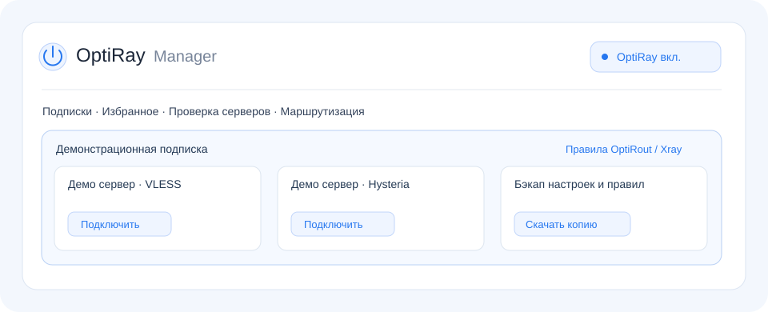

# OptiRay

**Веб-интерфейс для Xray, Hysteria и маршрутизации на Keenetic с Entware.**

OptiRay работает на Go, управляет подписками и собственными процессами прокси-ядер, помогает выбирать серверы и настраивать маршрутизацию через OptiRout или правила Xray. Python на роутере не требуется.



> Версия **1.0.2** — тестовый выпуск. Изображение выше — иллюстрация интерфейса с демонстрационными данными.

## Возможности

- Подписки, HWID и профили клиента Happ, Incy и OptiRay/Keenetic.
- Избранное, поиск, сортировка, карточки и список серверов.
- TCP- и HTTP-проверки, отмена проверки, автоматический выбор сервера.
- Установка и управление Xray и Hysteria, переключение серверов и восстановление процессов.
- Правила OptiRout и Xray: группы, сетевые интерфейсы, импорт и экспорт XLSX.
- Кнопка питания OptiRay с сохранением состояния; независимое включение OptiRout.
- Полный бэкап настроек, HWID и маршрутизации, восстановление и сброс.
- Светлая и тёмная темы, адаптивный интерфейс, HTTP Basic-аутентификация.

## Требования

Keenetic с установленной Entware и доступом к её консоли от root. Поддерживаемые сборки: ARM64 (`aarch64`) и MIPSel (`mipsle`, softfloat). Установщик проверяет архитектуру, зависимости и доступное место до остановки текущей службы.

Временные файлы и резервная копия обновления хранятся в `/tmp`. Для роутера с небольшим накопителем нужен достаточный запас оперативной памяти; при необходимости можно указать каталог USB через `OPTIRAY_INSTALL_TMPDIR`.

## Установка и обновление

Текущий сервер распространения: `http://example.com/optiray_go`.

```sh
opkg update && opkg install curl ca-bundle &&
curl -fL http://example.com/optiray_go/install.sh \
  -o /tmp/install-optiray-go.sh &&
sh /tmp/install-optiray-go.sh http://example.com/optiray_go
```

Установщик выбирает пакет, проверяет SHA256, устанавливает зависимости и запускает службу. В конце выводится адрес интерфейса, например `http://192.168.1.1:3883` или `http://192.168.10.1:3883` — в зависимости от адреса роутера.

Файлы программы: `/opt/etc/optiray-go`. При обновлении настройки сохраняются. Перед первым переходом с другой установки сохраните полный бэкап.

## Управление службой

```sh
/opt/etc/init.d/S99optiray-go start
/opt/etc/init.d/S99optiray-go stop
/opt/etc/init.d/S99optiray-go restart
/opt/etc/init.d/S99optiray-go status
```

Удаление:

```sh
sh /opt/etc/optiray-go/uninstall.sh
```

Удаляются файлы, служба, hook и управляемое прокси-подключение OptiRay. Общие пакеты Entware сохраняются. Подробности установки и миграции: [руководство](go-optiray/README.md).

## Что важно знать

- Установка ядер из интерфейса пока использует временное место в `/opt`. На небольшом накопителе может потребоваться ручная установка через `/tmp`.
- Некоторые сервисы подписок не распознают профиль OptiRay/Keenetic. Для них выберите Happ и включите HWID, если этого требует провайдер.
- TUIC и AnyTLS отображаются как неподдерживаемые; их запуск не реализован.
- Проверка на других моделях Keenetic приветствуется. При сообщении об ошибке укажите архитектуру и версию прошивки.

## Разработка

Go **1.23.12** и PowerShell 7. Исходники интерфейса находятся отдельно в `go-optiray/assets/`.

```sh
cd go-optiray
go test ./...
go vet ./...
```

Из корня репозитория, в PowerShell:

```powershell
./go-optiray/package.ps1
```

Собираются ARM64 и MIPSel пакеты с контрольными суммами. Сборка не обновляет роутер.

Структура:

| Каталог | Содержимое |
| --- | --- |
| `go-optiray/` | Go-приложение, тесты и сборка |
| `go-optiray/assets/` | HTML, CSS, JavaScript и стандартные конфигурации |
| `go-optiray/server-files/` | Установка, удаление, служба и netfilter hook |
| `research/OptiRout/src/backend/` | Соответствующие исходники модифицированного OptiRout и зависимости |
| `docs/` | Материалы для документации |

## Обратная связь

Нашли ошибку — создайте Issue по шаблону. Предлагаете функцию — опишите сценарий использования. Не публикуйте ссылки подписок, HWID, пароли, ключи и полные бэкапы.

- [Изменения 1.0.2](go-optiray/CHANGELOG.md)
- [Участие в разработке](CONTRIBUTING.md)
- [Сообщение об уязвимости](SECURITY.md)

## Лицензия и благодарности

OptiRay распространяется под **GNU GPL v3**. OptiRout основан на [MagiTrickle](https://github.com/MagiTrickle/MagiTrickle); исходные авторы, лицензия и описание изменений сохранены. Xray и Hysteria загружаются отдельно и распространяются под собственными лицензиями. Лицензии зависимостей сохранены в соответствующих каталогах.

См. [LICENSE](LICENSE) и [уведомление OptiRout](go-optiray/assets/NOTICE.optirout).
